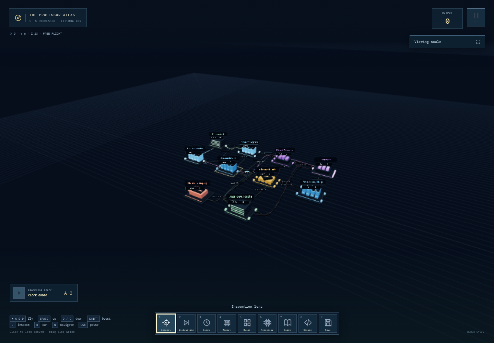

# Silicon Trails

A spatial computer architecture game in the browser. Fly through a machine, inspect a working processor, build connected circuits, and follow instructions as they change registers and memory.

[Source repository](https://github.com/toanminhbui/silicon-trails)



## What works

- **Explore:** start a guided journey or fly freely through the processor in first person. Move in the direction you look, rise or descend, and interact with components from every side.
- **Choose your scale:** resize the entire component set, spread the layout apart, or resize one selected component. These controls affect the view; they preserve circuit state and behavior.
- **Learn through actions:** the guided journey tracks actual movement, accumulator inspection, instruction execution, a committed memory write, memory inspection, and opening the RTL workbench.
- **Pause and inspect:** Escape opens the pause menu and RTL workbench. Choose processor code, memory, execution traces, or cache tools without leaving the world. Player movement and automatic processor execution stop while paused; manual debug steps still work.
- **Build:** enter the building sandbox from the pause menu. Its 16-part library includes arithmetic, comparisons, shifts, gates, inputs, switches, multiplexers, registers, and outputs. Connect actual ports and export the construction as structural Verilog.
- **Synthesize:** edit Verilog in the paused workbench and run real Yosys locally in a browser worker. Examples include a full adder, counter, enabled accumulator, and complete processor.
- **Study out-of-order execution:** enter a separate cycle-based architecture lab with decode, dispatch, register maps, physical registers, reservation stations, a load/store queue, execution units, and a reorder buffer. Follow real readiness, forwarding, and retirement events from its teaching model.
- **Execute and remember:** assemble programs, step clocks or instructions, inspect retirement traces, and rewind clock edges. Inspect all 256 byte addresses, committed writes, mapped devices, and simulated cache contents. The processor executes through its synthesized cells.
- **Save:** local autosave plus JSON world import/export for source, compiled circuit, construction, program, settings, guided-journey progress, and live processor state. Continue retains registers, RAM, cache, and pending transactions; rewind history starts fresh.

The default processor is precompiled and opens without loading the synthesis engine. The first custom synthesis fetches roughly **7.4 MiB of compressed WebAssembly**, plus runtime assets, from the same site. Synthesis runs locally; Verilog source is not uploaded to a compilation service.

## Development

Requires **Node.js 22 or newer** and npm.

```sh
npm ci
npm run dev
```

Open the Vite URL printed in the terminal, normally `http://localhost:5173`. Development and production builds automatically prepare the locally served Yosys assets.

```sh
npm test
npm run build
npm run preview
```

For browser checks:

```sh
npx playwright install chromium
npm run build
npm run test:e2e
```

Regenerate the bundled examples after changing their RTL:

```sh
npm run generate:examples
```

Unit and integration tests cover real synthesis, connected construction behavior, simultaneous register updates, processor retirement against an independent instruction model, memory acknowledgement, cache equivalence, and rewind.

## Try it

1. Select **Start guided journey**. Fly with WASD, look around with the mouse, rise with **Space**, and descend with **Q** or **C**. Hold **Shift** for a speed boost. Use **E** to inspect a component.
2. Advance the processor with **Step instruction**. `LDI 7` captures 7, `ADDI 5` produces 12, and `STORE 0x40` saves that byte in RAM.
3. Press **Escape**, choose **Memory bank**, and select address `40`. It contains `0C` (decimal 12), with the originating STORE and commit clock. `STORE 0xFE` updates the world’s numeric display.
4. In the pause menu, choose **Load program** and “Sum 1 through 10.” The loop saves 55 at address `40` and sends it to the display.
5. Choose **Processor RTL**, edit an example, and select **Synthesize**. The resulting circuit remains explorable in the world. Choose **Resume world** to return to playing.
6. Choose **Build sandbox** to construct a circuit. Use the hotbar or **All components** (**B**) to choose a part, aim at an empty grid location, and press **E** to place it. Feed an adder into a register, capture its result, and change an input. The register holds its previous value until the next enabled clock edge. Equal and Less than produce one-bit control signals for register enables and mux selection.
7. Open **Viewing scale** in the HUD to change component size or layout spacing. Inspect a component to change its individual scale. The pause menu’s **Component navigator** helps locate parts in a large design.

The gameplay HUD keeps processor run/step controls within reach. The detailed editor, memory grid, and debugging panels appear in paused workbenches.

Continue restores the machine and journey while returning the camera to its starting viewpoint. Reset processor deliberately clears its RAM and execution state.

## Model and scope

This MVP combines a freely navigable circuit space, an event-driven introductory journey, primitive circuit construction, and paused processor workbenches. The hardware simulation uses a single shared rising-edge clock and data paths up to 32 bits. RAM, program ROM, cache timing, and mapped devices are external services. Placement, viewing scale, and cable length do not change execution timing.

The supplied ST-8 is a complete, executable 8-bit processor implemented in Verilog. The visual Builder supplies gates, arithmetic, routing, and registers for smaller circuits; it does not yet provide a complete processor-construction kit with editable register files, memory ports, decoders, or a processor verification harness. Use the RTL workbench to change the supplied CPU or define a complete processor within the supported circuit model.

The out-of-order architecture lab uses its own assembly and high-level cycle model. It demonstrates register renaming, independent execution, load/store ordering, forwarding, and in-order retirement. It is separate from the synthesized ST-8 and has no branches, branch speculation, exceptions, or editable RTL implementation. See [the processor architecture guide](docs/processor-architecture.md) for experiments, named components, and construction limits.

The synthesis result retains source hierarchy as data; the current UI presents a curated CPU overview or flattened cells. Construction exports to Verilog; arbitrary Verilog does not round-trip into editable construction blocks. Unsupported latches, tri-states, native memory cells, multiple/gated clocks, combinational loops, and wider data paths produce explicit errors.

Future directions include a longer build-challenge campaign, reusable player-defined modules, deeper hierarchy navigation, and more processor architectures. See [the game design](docs/design.md) and [the simulator model](docs/simulator.md) for the learning progression and precise execution rules.

## Code map

| Area | Entry point |
| --- | --- |
| Processor and example RTL | [src/rtl/examples.js](src/rtl/examples.js) |
| Browser synthesis | [src/rtl/compiler.js](src/rtl/compiler.js) |
| Generic circuit execution | [src/core/simulator.js](src/core/simulator.js) |
| ROM, RAM, cache, and processor debugging | [src/core/cpu-lab.js](src/core/cpu-lab.js) |
| Assembly and sample programs | [src/core/assembler.js](src/core/assembler.js) |
| Editable block construction | [src/ui/builder.js](src/ui/builder.js) |
| Architecture overview mapping | [src/ui/cpu-overview.js](src/ui/cpu-overview.js) |
| Out-of-order teaching model | [src/core/ooo-lab.js](src/core/ooo-lab.js) |
| Named out-of-order components and event mapping | [src/ui/ooo-overview.js](src/ui/ooo-overview.js) |
| Pipeline-state workbench | [src/ui/architecture-panel.js](src/ui/architecture-panel.js) |
| Spatial rendering | [src/world/world.js](src/world/world.js) |
| Event-driven guided journey | [src/game/tutorial.js](src/game/tutorial.js) |
| Saved machine checkpoints | [src/game/snapshot.js](src/game/snapshot.js) |

Module interfaces are documented in [the implementation contract](docs/implementation-contract.md).
