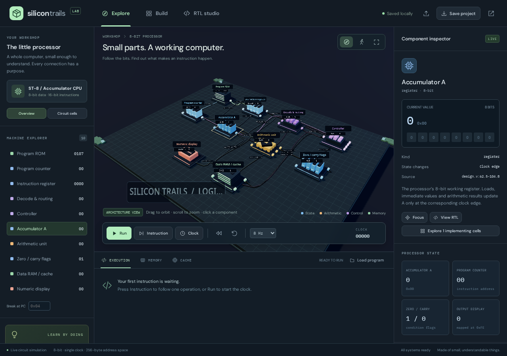

# Silicon Trails

A Minecraft-inspired computer architecture workshop in the browser. Build connected circuits, explore a working processor, and follow instructions as they change registers and memory.

[Source repository](https://github.com/toanminhbui/silicon-trails)



## What works

- **Explore:** a spatial overview of the ST-8 accumulator processor, live signals, component inspection, and links from overview blocks to their implementing cells. Orbit the board or use walk mode.
- **Build:** place inputs, switches, gates, adders, multiplexers, registers, and outputs; connect their actual ports; change inputs and step the shared clock. Export the construction as structural Verilog.
- **RTL:** edit synthesizable Verilog and run real Yosys synthesis locally in a browser worker. Examples include a full adder, counter, enabled accumulator, and complete processor.
- **Execute:** assemble programs, step clocks or instructions, run to a breakpoint, inspect retirement traces, and rewind clock edges. The processor executes through its synthesized cells.
- **Memory:** inspect all 256 byte addresses, committed writes, mapped input/output, and an optional simulated cache with visible tags, data, hits, and misses.
- **Save:** local autosave plus JSON project import/export for source, compiled circuit, construction, program, and settings. Restoring a project restarts execution.

The default processor is precompiled and opens without loading the synthesis engine. The first custom synthesis fetches roughly **7.4 MiB of compressed WebAssembly**, plus runtime assets, from the same site. Synthesis runs locally; Verilog source is not uploaded to a compilation service.

## Development

Requires **Node.js 22 or newer** and npm.

```sh
npm ci
npm run dev
```

Open the Vite URL printed in the terminal, normally `http://localhost:5173`. Development and production builds automatically prepare the locally served Yosys assets.

```sh
npm test
npm run build
npm run preview
```

For browser checks:

```sh
npx playwright install chromium
npm run build
npm run test:e2e
```

Regenerate the bundled examples after changing their RTL:

```sh
npm run generate:examples
```

Unit and integration tests cover real synthesis, connected construction behavior, simultaneous register updates, processor retirement against an independent instruction model, memory acknowledgement, cache equivalence, and rewind.

## Try it

1. In **Explore**, step through “Save 7 + 5.” After `STORE 0x40`, memory address `40` contains `0C` (decimal 12). `STORE 0xFE` sends the value to the numeric display.
2. Load “Sum 1 through 10.” The loop saves 55 at address `40` and sends it to the display.
3. In **Build**, step the sample adder/register circuit, then change an input. The register holds its previous value until the next enabled clock edge.
4. In **RTL**, edit an example and select **Synthesize**. Switch to circuit cells to inspect the resulting implementation.

## Model and scope

This MVP provides a block workshop and processor laboratory. The current simulation uses a single shared rising-edge clock and data paths up to 32 bits. RAM, program ROM, cache timing, and mapped devices are external services. Physical placement and cable length do not change execution timing.

The synthesis result retains source hierarchy as data; the current UI presents a curated CPU overview or flattened cells. Construction exports to Verilog; arbitrary Verilog does not round-trip into editable construction blocks. Unsupported latches, tri-states, native memory cells, multiple/gated clocks, combinational loops, and wider data paths produce explicit errors.

Future directions include guided build challenges, reusable player-defined modules, deeper hierarchy navigation, and more processor architectures. See [the game design](docs/design.md) and [the simulator model](docs/simulator.md) for the learning progression and precise execution rules.

## Code map

| Area | Entry point |
| --- | --- |
| Processor and example RTL | [src/rtl/examples.js](src/rtl/examples.js) |
| Browser synthesis | [src/rtl/compiler.js](src/rtl/compiler.js) |
| Generic circuit execution | [src/core/simulator.js](src/core/simulator.js) |
| ROM, RAM, cache, and processor debugging | [src/core/cpu-lab.js](src/core/cpu-lab.js) |
| Assembly and sample programs | [src/core/assembler.js](src/core/assembler.js) |
| Editable block construction | [src/ui/builder.js](src/ui/builder.js) |
| Architecture overview mapping | [src/ui/cpu-overview.js](src/ui/cpu-overview.js) |
| Spatial rendering | [src/world/world.js](src/world/world.js) |

Module interfaces are documented in [the implementation contract](docs/implementation-contract.md).
