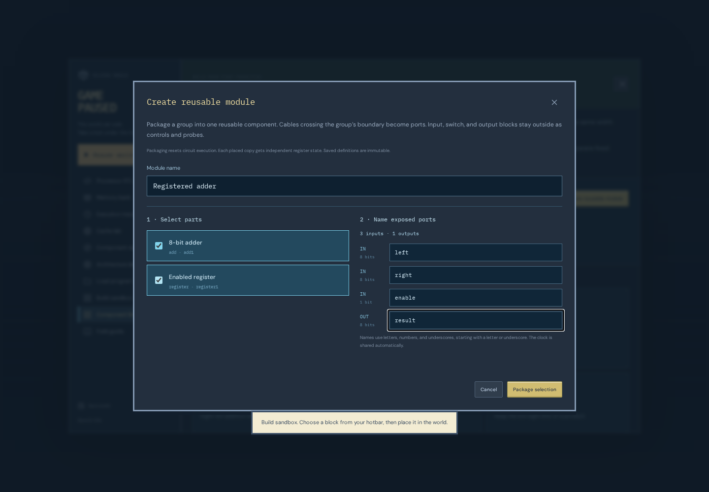

# Build a component from a circuit

A reusable module packages a working subcircuit behind named, typed ports. Its saved definition describes hardware. Every placed instance gets its own registers in the executable circuit; instances do not share a captured value merely because they share a definition.

The module workflow is part of **Build sandbox**. It is separate from the RTL compiler’s saved source hierarchy and from the fixed out-of-order teaching model.

## Package the sample’s registered adder

1. Enter **Build sandbox** from the pause menu. The sample has inputs 7 and 5, an adder, an enabled register, and an output. Step its clock once: the output becomes 12.
2. Pause and open **Component library**, then choose **Create reusable module**.
3. Select **8-bit adder** and **Enabled register**. Leave the root inputs, write-enable switch, and output outside the selection. Input, switch, and output nodes are root connections rather than packageable functional nodes.
4. Give the module a name, such as **Registered adder**. Review the inferred boundary. The adder’s A and B inputs require eight bits each; the register’s enable requires one bit; its Q output supplies eight bits. The adder-to-register connection stays internal.
5. Rename the exposed ports if useful: `left`, `right`, `enable`, and `result` explain the interface without exposing its implementation. Port widths and directions follow the selected circuit. Review validation messages before packaging.
6. Choose **Package selection**. The two selected parts become one module instance. The original input and output cables reconnect through its inferred boundary.
7. Step the clock again. The same inputs still produce 12. Changing Input A from 7 to 9 changes the combinational sum immediately, while the module’s captured result remains 12 until the next enabled edge; that edge captures 14.

Packaging changes the construction and resets execution, just like placing a part or rewiring it. It preserves the logical connections, not the register value captured before the topology edit. Initially unknown registers become known through the circuit’s normal clocking and enable behavior.

Boundary inference follows wires. Inputs fed by the same external driver share one exposed input with multiple internal bindings. Disconnected internal inputs become exposed inputs and remain unknown until driven. Outputs used outside the selection, or left unused, become exposed outputs. Port names must be distinct hardware identifiers; renaming a port does not change its width or direction. The clock is connected automatically rather than added to the editable port list.

## Place another instance

The saved definition appears in **Component library** beside the primitive parts. Choose its card to return to flight with the module selected, aim at an empty grid location, and press **E** to place it. Connect cables to its exposed ports using the normal width checks.

A second registered adder can capture a different sum or hold while the first one updates. Both receive the same shared rising-edge clock, but their physical simulator registers are distinct. A disconnected input remains unknown; the library does not silently supply the first instance’s input values to its copies.

Definitions are immutable in this version. Changing a root input affects only the wires connected to that input. It does not edit the saved module’s design. To create a larger component, compose existing instances and other functional parts, then package that root selection into a new definition.

## Nest modules

Module instances can participate in a new package selection along with ordinary gates, arithmetic, routing, or registers. The resulting definition contains references to its child definitions. Its exposed boundary again comes from the selected circuit’s external connections.

This makes a useful progression possible: package a datapath operation, combine operations with state and control, then reuse that larger component. A child definition can appear in several parents without sharing runtime state between their instances.

Definitions must form a finite, nonrecursive hierarchy. Invalid definitions, missing references, recursive dependencies, invalid port mappings, and unsupported nesting are rejected. Normal circuit restrictions still apply: matching bus widths, one driver per input, one shared clock, and no combinational loops.

Structural Verilog export retains module declarations and instances, including nested references and the shared clock. The runtime expands those same definitions into one executable cell netlist. Exported hardware and live inspection therefore describe the same connected construction at different levels.

## Explore live internals

Inspect an instance and choose **Open module**. The world shows that instance’s internal components and boundary ports. The breadcrumb identifies the current instance path and returns to a parent or the root circuit. Opening a nested instance continues down the same hierarchy.

This is a live view of the running root circuit. Opening and closing it neither creates a second simulator nor resets a clock, register, or rewind history. Inspect a register, change an external input at the root, or advance a clock to see how the selected instance behaves. Two copies can show different values even though their internal component labels match.

Internal views are read-only in this version: inspect signals and advance simulation there; place, remove, wire, or package components at the root. The saved definition is not edited through one instance. Returning to its parent preserves the same machine state.

## Save and check

Autosave and exported world JSON include reusable definitions, root instances, their connections, and the executable circuit’s checkpoint. Continue restores captured values inside nested instances as well as root register/input values. Rewind history starts fresh after loading, as it does for other saved constructions.

Useful checks for a new module are:

- Verify its boundary widths and directions against the intended interface.
- Exercise arithmetic boundary values, unknown inputs, and register enables.
- Place two copies with different inputs or enables and verify independent captured state.
- Connect two clocked instances in a chain and verify that both sample the old state on the same edge.
- Open a nested instance, clock the circuit, and confirm the displayed internals match the parent’s behavior.
- Export or save/reload the construction and repeat the experiment.

A packaged component retains the behavior of its connected hardware. Naming it “CPU,” “cache,” or “reorder buffer” does not add those behaviors. The [processor architecture guide](processor-architecture.md) describes the facilities still needed for a complete visual processor kit.
